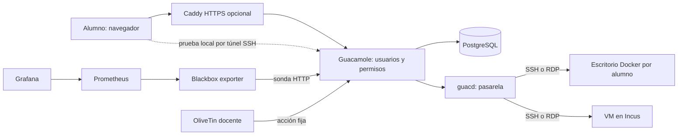

# Laboratorio de aulas: Guacamole, Docker e Incus

Guía en español para entregar a cada alumno un escritorio o terminal desde el navegador. Empezá con un alumno y agregá componentes cuando hagan falta.

**Estado de pruebas:** [evidencia real](docs/PRUEBAS.md). Un portal HTTP sano no prueba una sesión remota. No se incluyen contraseñas ni infraestructura privada del autor.



Guacamole autentica y conecta; **no crea VMs**. `guacd` convierte protocolos hacia máquinas existentes. PostgreSQL guarda usuarios, conexiones y permisos. Incus administra cómputo; Grafana observa; OliveTin ofrece operaciones predefinidas.

## Etapas

1. [Preparar el host](docs/00-preparacion.md).
2. Levantar el portal mínimo (abajo).
3. [Escritorios Docker y permisos](docs/02-escritorios.md).
4. [VMs con Incus](docs/03-incus.md).
5. [Grafana y Prometheus](docs/04-observabilidad.md).
6. [OliveTin](docs/05-olivetin.md).
7. [Caddy y HAProxy](docs/06-proxies.md).
8. [Operación de clase y backup](docs/07-operacion.md).

## Portal mínimo

En Linux con Docker Engine, Compose v2, Git y Python3. Comandos Bash, no PowerShell:

```bash
git clone https://github.com/villadalmine/lab-aulas-guacamole.git
cd lab-aulas-guacamole
bash scripts/preparar.sh
docker compose up -d
docker compose ps
docker compose logs --tail=80 guacamole postgres guacd
curl --fail http://127.0.0.1:18080/guacamole/ -o /dev/null
```

Esperá PostgreSQL `healthy` y el arranque de Tomcat. Abrí `http://localhost:18080/guacamole/`. Si Docker está en un servidor remoto, en **tu computadora**:

```bash
ssh -N -L 18080:127.0.0.1:18080 usuario@SERVIDOR
```

Usuario inicial **guacadmin / guacadmin**. Cambiá esa clave antes de publicar, creá un administrador propio y comprobá que la clave inicial ya no funciona. La clave de PostgreSQL no es la del portal.

El script genera claves locales distintas en `.env` y el esquema SQL oficial. PostgreSQL importa el esquema solamente al inicializar un volumen vacío. Cambiar `.env` no cambia claves ya guardadas en una base existente.

## Primer alumno

```bash
docker compose --profile escritorio up -d --build
```

En Guacamole: Configuración → Conexiones → Nueva. Para SSH: nombre `alumno01-ssh`, servidor `escritorio`, puerto `22`, usuario `alumno`, clave `DESKTOP_PASSWORD` de `.env`. Para RDP: mismo servidor/usuario, puerto `3389`; ver [modo de seguridad y prueba gráfica](docs/02-escritorios.md).

Crear cuenta Guacamole de alumno y asignarle solo su conexión. Probar también como alumno, no únicamente como administrador. No publicar 22, 3389, 4822 ni 5432 en Internet.

## Agregar componentes

```bash
docker compose -f compose.yaml -f compose.observabilidad.yaml --profile escritorio up -d --build
# Grafana localhost:13000; usuario docente, clave GRAFANA_PASSWORD.
docker compose -f compose.yaml -f compose.observabilidad.yaml -f compose.olivetin.yaml --profile escritorio up -d --build
# OliveTin localhost:1337; acceso exclusivo del docente por túnel.
docker compose -f compose.yaml -f compose.caddy.yaml --profile escritorio up -d --build
# https://localhost:18443/guacamole/ (CA interna de laboratorio).
docker compose -f compose.yaml -f compose.caddy.yaml -f compose.haproxy.yaml --profile escritorio up -d --build
# https://localhost:19443/guacamole/ (HAProxy TCP → Caddy TLS).
```

Usar el mismo conjunto de `-f` al operar cada instalación. Puertos publicados solo en loopback. Para paneles remotos agregar los respectivos `-L` al túnel SSH. TLS interno no equivale a certificado público: ver [publicación](docs/06-proxies.md).

## Continuidad

[Plan e hitos](docs/HITOS.md), [retomar desde Fedora](docs/CONTINUIDAD.md), [AGENTS.md](AGENTS.md) y [skill portable](skills/lab-aulas/SKILL.md). GitHub es la fuente compartida; `.env` y datos de alumnos no van en Git.

El código y textos propios se publican bajo MIT; imágenes y programas mantienen sus licencias. Para alumnos no confiables con sudo/root, preferir VMs y segmentación. [Fuentes oficiales](docs/FUENTES.md).
