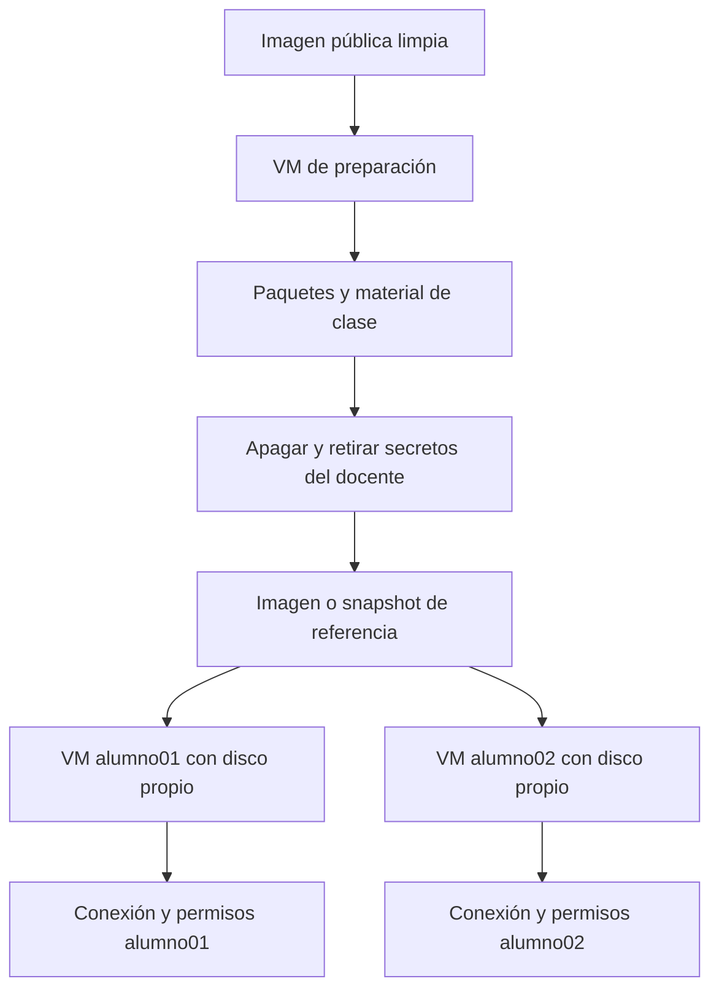

# 3. Incus: VMs para alumnos

Instalar Incus en un host Linux con KVM. En Ubuntu 24.04 existe paquete nativo. Inicializar con `incus admin init` **solo en host nuevo**; en un servidor existente revisar perfiles/red/pool sin ejecutar auto-init.

Con un perfil default que incluya disco root y red:

```bash
incus launch images:ubuntu/24.04/cloud alumno01 --vm -c limits.cpu=2 -c limits.memory=2GiB -d root,size=12GiB
incus list
incus exec alumno01 -- cloud-init status --wait
incus exec alumno01 -- bash
```

Dentro de esa VM:

```bash
apt-get update
apt-get install -y openssh-server
adduser alumno
systemctl enable --now ssh
ip -4 addr
```

Elegir la contraseña interactivamente y no publicarla. Crear conexión Guacamole SSH a su IP. El bridge NAT de Incus permite salida, pero no garantiza acceso desde otro host: revisar rutas y firewall entre guacd y esa IP. No exponer la API/socket Incus para resolverlo.

Para escritorio, instalar `xfce4 xrdp xorgxrdp dbus-x11`, configurar `~alumno/.xsession` con `startxfce4` y habilitar xrdp. La consola `incus console alumno01 --type=vga` es un diagnóstico distinto a RDP.

## Reproducir Docker dentro de una VM

Crear una VM `aula-docker` de 4 CPU / 6 GB / 20 GB, instalar Docker y clonar el repo dentro. Evita instalar Docker en el host Incus y no requiere `security.nesting` en un contenedor de sistema.

En un host nuevo, con el perfil y bridge ya preparados:

```bash
incus launch images:ubuntu/24.04/cloud aula-docker --vm \
  -c limits.cpu=4 -c limits.memory=6GiB -d root,size=20GiB
incus exec aula-docker -- cloud-init status --wait
incus exec aula-docker -- apt-get update
incus exec aula-docker -- apt-get install -y docker.io docker-compose-v2 git python3
incus exec aula-docker -- systemctl enable --now docker
incus exec aula-docker -- bash
# Ya dentro de la VM:
git clone https://github.com/villadalmine/lab-aulas-guacamole.git /opt/aulas
cd /opt/aulas
bash scripts/preparar.sh
docker compose --profile escritorio up -d --build
```

Para acceder desde tu computadora, la publicación sigue siendo loopback **dentro de la VM**. Crear un usuario SSH en ella y usar el túnel de README hacia su IP. Si la VM solo es accesible desde el host Incus, usar `ssh -J usuario@HOST_INCUS -N -L 18080:127.0.0.1:18080 usuario@IP_VM`. No abrir puertos de todos los servicios como atajo.



La base se prepara una vez; VM, HOME y cuenta Guacamole se separan por alumno. No clonar claves privadas del docente. Restaurar snapshots o eliminar VMs destruye cambios: decidirlo aparte y preservar entregas.

Ejemplos sobre la VM propia: `incus stop alumno01`, `incus start alumno01`, `incus snapshot create alumno01 antes-clase`. Comprobar resultados. Ver PRUEBAS.md: la creación de proyecto en el host de prueba quedó bloqueada; no se anuncia como prueba exitosa.
