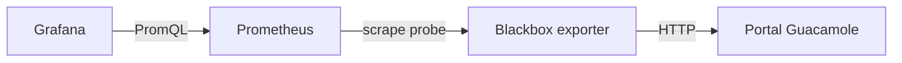

# 4. Grafana y Prometheus

Agregar `compose.observabilidad.yaml` a la base. Grafana: localhost13000, usuario `docente`, clave local `GRAFANA_PASSWORD`. Datasource y dashboard **Laboratorio de aulas** se aprovisionan desde archivos del repo.

Verificar `curl --fail http://localhost:13000/api/health`. En Prometheus consultar `probe_success{job="guacamole_http"}`: debe dar1 después del primer scrape. El1 prueba HTTP, no el login, Postgres, SSH o una clase completa.

Extensiones: node_exporter por host, métricas Incus con certificado dedicado lector, postgres_exporter, Loki/Alloy y alertas de recursos/vencimiento de sondas. No entregar acceso admin Incus a Grafana. Una VM apagada por el docente no debe generar automáticamente una falsa avería.
