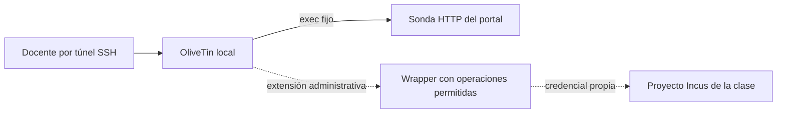

# 5. OliveTin: panel docente

La demo escucha solo en loopback y trae dos acciones fijas: consultar HTTP de Guacamole y mostrar fecha. No tiene acceso al host, al motor Docker ni a Incus. Probar el botón y su salida, no solo la página inicial.

Para encender/apagar VMs, una implementación administrada puede usar un wrapper `lab-control start alumno01`: valida operación/nombre, limita a proyecto propio, verifica resultado y audita. Agregar autenticación, ACL docente y confirmación para destructivos. No pasar texto arbitrario a shell.

No montar `docker.sock` ni el socket Incus en el panel público: dan control del motor. Preferir backend de operaciones estrecho con credencial dedicada y acceso docente por VPN. Los dos botones del ejemplo no implementan esa administración completa; el orquestador privado del autor no se distribuye aquí.
