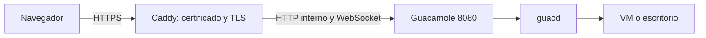
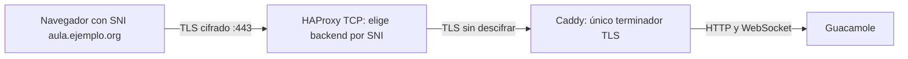

# 6. Caddy y HAProxy

## A. Un servidor: Caddy termina TLS



`compose.caddy.yaml` publica localhost:18443 y usa CA interna de laboratorio. Caddy hace upgrade WebSocket automáticamente con `reverse_proxy`. No usar `handle_path` que quite `/guacamole` mientras la aplicación mantiene ese contexto.

```bash
docker compose -f compose.yaml -f compose.caddy.yaml cp caddy:/data/caddy/pki/authorities/local/root.crt ./root-lab.crt
curl --cacert root-lab.crt https://localhost:18443/guacamole/ --fail -o /dev/null
```

Se copia el certificado público, nunca la clave privada de la CA. En el navegador confiar esa CA local solo en el equipo de pruebas o usar un dominio y certificado público. No desactivar la validación TLS global.

Para Internet: dominio propio con A/AAAA correctos, puertos 80/443 alcanzables y Caddy configurado para ese dominio. Ejemplo del bloque:

```caddyfile
aula.ejemplo.org {
    redir / /guacamole/
    reverse_proxy /guacamole/* guacamole:8080
}
```

Modificar el archivo montado y publicar 80/443 mediante un Compose específico del servidor; la demo deja loopback por defecto. Revisar CGNAT/IPv6 y challenges ACME. DNS-01 necesita proveedor/configuración adicional. No cambiar DNS ni routers privados del autor.

## B. Borde compartido: HAProxy TCP/SNI → Caddy TLS



Este patrón refleja la arquitectura del lab original, con nombres privados omitidos. HAProxy passthrough no tiene certificados ni modifica cabeceras HTTP. Caddy recibe ClientHello y, si se usa, el challenge TLS-ALPN. No poner `bind ... ssl` en HAProxy en esta variante.

La demo usa 19443→HAProxy:443→Caddy:443 con SNI localhost. Probar:

```bash
curl --cacert root-lab.crt https://localhost:19443/guacamole/ --fail -o /dev/null
```

Hay timeouts TCP de 1 h para sesiones; validar también una sesión WebSocket real. Un curl 200 no prueba escritorio.

### IP real y PROXY protocol

El ejemplo mínimo **no envía PROXYv2**; Caddy verá la IP del proxy. La arquitectura original usa `send-proxy-v2` y un listener Caddy que interpreta PROXY **antes** de TLS. Para extenderlo verificar soporte con `caddy list-modules` y configurar ambos extremos. Ejemplo conceptual de listener:

```caddyfile
{
    servers {
        listener_wrappers {
            proxy_protocol {
                allow IP_DEL_HAPROXY/32
            }
            tls
        }
    }
}
```

Puede requerir módulo adicional según el binario elegido. No se activa en la demo. Confiar PROXY solo del borde esperado; si un extremo lo espera y el otro no lo emite, TLS falla. No confiar cabeceras de cualquier cliente.

Terminar TLS en HAProxy es otra arquitectura: modo HTTP, certificados en HAProxy, `timeout tunnel`, WebSocket y cabeceras Forwarded. No mezclar esa receta con TCP/SNI.

## Paneles docentes

Grafana/OliveTin quedan fuera de la publicación pública: acceso por VPN/SSH y ACL. Antes de dar acceso a alumnos cambiar claves iniciales, permisos mínimos, segmentación/egress,backup y sesión real. No exponer guacd.
